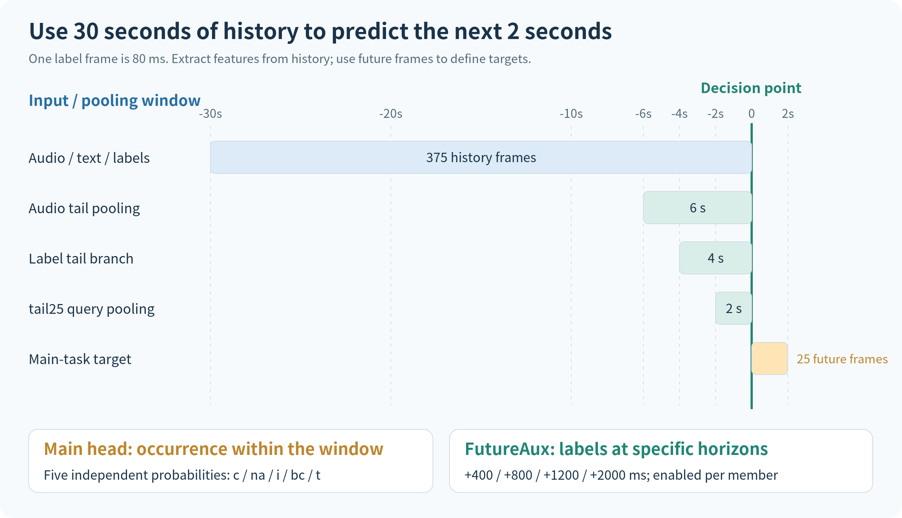
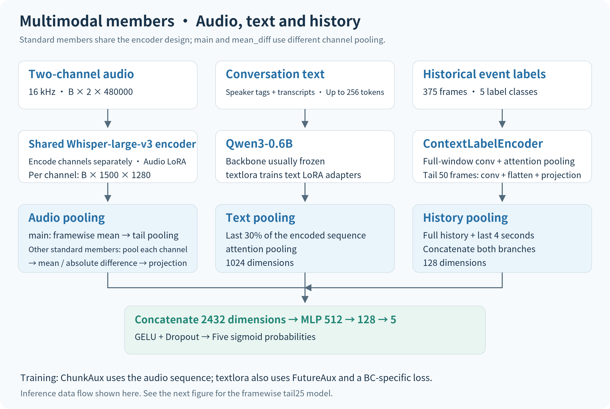
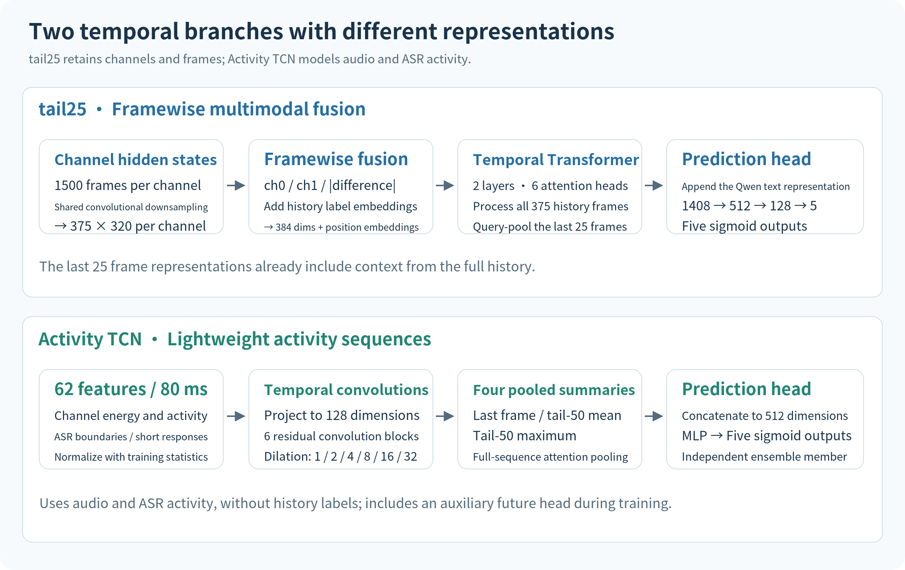
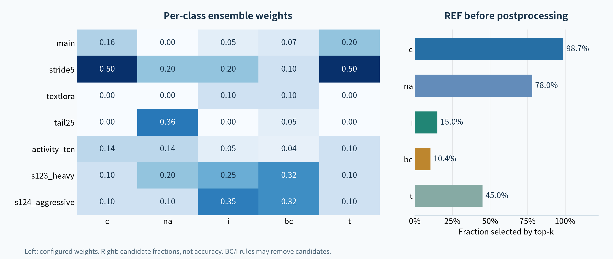
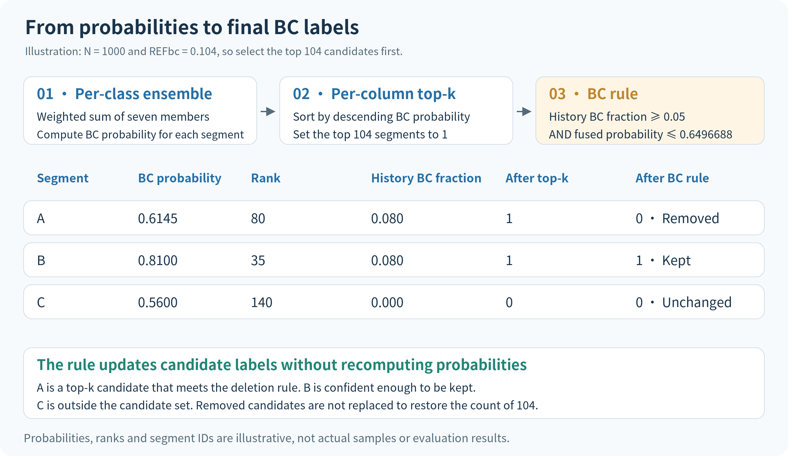

# Xinye Technology Cup: Multimodal Turn-Taking Prediction

[简体中文（默认）](README.md) | **English**

A pause in a phone conversation may mean that the current speaker will continue or that the other person is about to respond. The second round of the 2026 Xinye Technology Cup's turn-taking interaction modeling competition asks models to read **30 seconds** of two-channel audio, transcripts, and historical event labels, then predict which conversational events will occur in the next **2 seconds**.

This solution combines **Whisper-large-v3 + Qwen3-0.6B** with historical states and a separate activity sequence model to produce seven sets of predictions. A per-class weighted ensemble combines them. REF top-k selects a candidate count for each class, followed by rules that filter BC and I predictions using historical backchannel rates and acoustic overlap features. The final configuration, **v161_bc104**, achieved a best second-round score of **0.668080 macro F1**.



[View SVG](assets/conversation-timeline.en.svg)

| Item | Final configuration |
|---|---|
| History / prediction window | 30 seconds / 2 seconds |
| Time grid | 80 ms per frame; 375 history frames and 25 future frames |
| Model inputs | Two-channel audio, transcripts, and historical event labels |
| Model outputs | Five independent probabilities: c, na, i, bc, t |
| Ensemble | Six multimodal members + one Activity TCN |
| Final decisions | Per-class weighting → REF top-k → BC rule → I rule |
| Best score | **0.668080 macro F1** |

**Contents:** [Task and inputs](#task-and-inputs) · [Multimodal model](#multimodal-model) · [Temporal and activity branches](#temporal-and-activity-branches) · [Training objectives](#training-objectives) · [The seven ensemble members](#the-seven-ensemble-members) · [Ensembling and calibration](#ensembling-and-calibration) · [Postprocessing rules](#postprocessing-rules) · [Code guide](#code-guide)

## Task and inputs

### Predicting events within a window

The model makes its prediction at the end of the current conversation segment. Each output column indicates whether an event will occur within the next 2 seconds:

| Column | Event | Meaning |
|---|---|---|
| c | Continuation | The current speaker continues speaking |
| na | No action | No-action state |
| i | Incomplete interruption | The other speaker attempts to interrupt without completing a turn takeover |
| bc | Backchannel | The listener gives a short response or feedback |
| t | Turn switch | The speaking turn moves to the other person |

Training data assigns one event label to each time frame. The main task converts all classes appearing in the next 25 frames into five binary targets. Several events may occur within a window, so the five outputs use independent sigmoids rather than a single five-way decision.

For future frame labels $\ell_{t},\ldots,\ell_{t+24}$, the main-task target for class $c$ is:

$$
y_c=\mathbb{1}\left[\exists k\in\{0,\ldots,24\}:\ell_{t+k}=c\right].
$$

Here, $c$ denotes an arbitrary class index. Frame labels are encoded as `C=0, T=1, BC=2, I=3, NA=4`, while probability matrices and submission files use the fixed column order **c, na, i, bc, t**. These orders must be mapped by class name.

### Three inputs provide different cues

Audio preserves speech activity and vocal changes on both sides. The original telephone audio is sampled at 8 kHz and resampled to 16 kHz for the model. A 30-second segment contains 480,000 samples per channel. Both channels pass separately through a shared Whisper encoder, retaining their own hidden states.

Text is collected from transcript segments within the time window and includes speaker markers. Qwen receives up to 256 tokens, followed by attention pooling over the last 30% of the encoded sequence. This supplies content cues, such as whether a response is short or a sentence is semantically continuing.

Historical event labels describe the preceding conversation state. Standard members encode both the full 375-frame history and its final 50 frames, then concatenate the two representations. The full branch captures a longer history; the tail branch captures local changes in the 4 seconds before the decision point.

In the figure, “last 6 seconds” refers to pooling over audio hidden states, and “last 2 seconds” refers to the `tail25` query-pooling range. The Whisper encoder still processes the full 30 seconds of audio.

## Multimodal model



[View SVG](assets/multimodal-architecture.en.svg)

### Audio encoding and two-channel pooling

The model computes Whisper-compatible log-mel features on the GPU and passes them through the Whisper-large-v3 encoder. Each 30-second channel produces approximately 1,500 encoded frames of 1,280 dimensions. LoRA adapts the audio backbone, while classification and pooling layers are trained.

Standard members use two approaches to combining channels.

`main` averages the two channel hidden states at each time position, then applies attention pooling to the last 300 frames to obtain a 1,280-dimensional audio vector.

`stride5`, `textlora`, `s123_heavy`, and `s124_aggressive` pool the final 300 frames of each channel separately, producing $u_0,u_1$. They then concatenate the channel mean and absolute difference:

$$
u_{\mathrm{mean}}=\frac{u_0+u_1}{2},\qquad
u_{\mathrm{diff}}=|u_0-u_1|,
$$

$$
a=\operatorname{GELU}\left(\operatorname{LayerNorm}\left(W_a[u_{\mathrm{mean}};u_{\mathrm{diff}}]+b_a\right)\right).
$$

The mean retains shared information, while the absolute difference represents differences between the two sides. A projection reduces the concatenated 2,560 dimensions to 1,280 for fusion with the other inputs. `tail25` uses a separate framewise architecture, described in the next section.

### Text and historical-state encoding

The text branch uses Qwen3-0.6B and produces a 1,024-dimensional vector. All multimodal members except `textlora` freeze the text backbone. `textlora` adds LoRA with rank 8 and alpha 16 to text attention projections. Text pooling remains part of the model.

The historical-state branch maps the five labels to 16-dimensional embeddings. The full-history branch uses two one-dimensional convolutions and attention pooling. The tail branch convolves the final 50 frames, flattens the result, and projects it. Each branch produces 64 dimensions, giving a concatenated 128-dimensional state vector.

### Three-way fusion and classification

Standard members concatenate audio, text, and historical state:

$$
f=[a;t;h]\in\mathbb{R}^{1280+1024+128}=\mathbb{R}^{2432}.
$$

An MLP maps `2432 → 512 → 128 → 5`, with GELU and dropout in the hidden layers. The five logits pass through sigmoid to produce five probabilities. Each member independently outputs an `[N, 5]` probability matrix for the ensemble.

## Temporal and activity branches



[View SVG](assets/temporal-branches.en.svg)

### tail25: Model framewise relations before pooling the tail

`tail25` downsamples each channel's 1,500 hidden-state frames with a one-dimensional convolution of kernel size 4 and stride 4. This produces 375 frames of 320 dimensions per channel, aligned with the historical-label time grid.

At each time position, it concatenates the two channels, their absolute difference, and the historical-label embedding. After projection to 384 dimensions and addition of positional embeddings, the sequence passes through a two-layer Transformer with six attention heads. A learnable query then cross-attends to the last 25 frames to produce a 384-dimensional audio-and-state representation.

Those 25 frame representations already incorporate the full history through the Transformer. The result is concatenated with the 1,024-dimensional text representation and passed to a `1408 → 512 → 128 → 5` classifier. Historical labels enter at the frame level here, bypassing the standard 128-dimensional state-pooling branch.

### Activity TCN: Model speech activity directly

Activity TCN uses **62 activity features** per 80 ms frame. Audio features include channel energy, peaks, activity masks, and combinations such as overlap, silence, and one-sided activity. Text features include ASR activity, short responses, character density, and utterance boundaries. This member uses audio and transcript information without historical event labels.

Features are standardized using training-set statistics and projected to 128 dimensions. Six residual temporal convolution blocks follow, with dilation rates `1, 2, 4, 8, 16, 32`. The output sequence is summarized in four ways: the last frame, the mean of the last 50 frames, the maximum of the last 50 frames, and attention pooling over the full sequence.

The four summaries form a 512-dimensional vector, and an MLP produces five event probabilities. Its input representation and architecture differ from the Whisper/Qwen members, providing another source for the ensemble. A multi-horizon future-prediction head is also used during training; the main inference output remains five probabilities.

## Training objectives

### Main task and framewise auxiliary supervision

The six multimodal members learn window-level multilabel targets with Robust Asymmetric Loss. The implementation weights positive and negative terms differently: the negative focusing exponent is 4, the positive focusing exponent is 0, the negative margin is 0.05, and negative loss is scaled by 1.5. Some members also increase the positive-class weights for selected events.

These settings reduce the contribution of easy negatives and place more emphasis on unresolved examples. The focusing weights are detached from the gradient computation; the classifier still learns through the five logits.

ChunkAux aligns the audio sequence to 375 frames and predicts the event label at each frame of the preceding 30 seconds. It uses cross-entropy with label smoothing of 0.1. This adds framewise supervision to the five window-level targets of the main task.

### FutureAux and member-specific losses

`textlora` and `tail25` also enable FutureAux. It uses tail hidden states from both channels to predict frame labels **400, 800, 1200, and 2000 ms** after the current time. Each target is a single frame's class, distinct from the main task's event occurrence anywhere in the future window.

The multimodal training objective can be written as:

$$
\mathcal{L}=\mathcal{L}_{\mathrm{ASL}}+
\lambda_{\mathrm{chunk}}\mathcal{L}_{\mathrm{chunk}}+
\lambda_{\mathrm{future}}\mathcal{L}_{\mathrm{future}}+
\lambda_{\mathrm{extra}}\mathcal{L}_{\mathrm{extra}}.
$$

Disabled terms have zero weight. ChunkAux uses weights `0.5 → 0.3 → 0.1`, with transitions at epoch indices 5 and 15 in the code. FutureAux has weight 0.3 when enabled.

Two member-specific losses add further differences. `textlora` adds BC binary cross-entropy with loss weight 0.3 and positive-class weight 20. For binary-target examples with exactly one positive class, `tail25` adds softmax cross-entropy with weight 0.3. This is an auxiliary constraint; the final outputs still use five independent sigmoids.

### Mix2 on fused features

Training also applies Mix2 to the concatenated fusion features. When triggered, it mixes two or three examples' features and main-task labels with matching coefficients, then evaluates the classifier again. It does not remix raw audio or concatenate framewise histories from different examples.

The default trigger probability is 0.5, with a Beta/Dirichlet parameter of 0.4 and at most three examples per mixture. Auxiliary heads retain supervision from the original inputs. The backbone interface is the same during training and inference.

## The seven ensemble members

The table below reflects the saved members' configurations and weight structures. A corresponding summary is available in [member-architecture.json](docs/member-architecture.json).

| Member | Audio / temporal architecture | Text backbone | Window sampling stride | Additional training terms |
|---|---|---|---|---|
| main | Framewise channel mean, then tail pooling | Frozen | 25 frames / 2 seconds | ChunkAux |
| stride5 | Separate channel pooling, mean + absolute difference | Frozen | 5 frames / 0.4 seconds | ChunkAux |
| textlora | Separate channel pooling, mean + absolute difference | Text LoRA | 25 frames / 2 seconds | ChunkAux, FutureAux, BC BCE |
| tail25 | 375-frame Transformer; query over the last 25 frames | Frozen | 25 frames / 2 seconds | ChunkAux, FutureAux, single-positive auxiliary CE |
| activity_tcn | 62 activity features; six residual convolution blocks | Uses ASR activity features | 25 frames / 2 seconds | Future-horizon auxiliary head |
| s123_heavy | Separate channel pooling, mean + absolute difference | Frozen | 25 frames / 2 seconds | ChunkAux, positive-class weighting |
| s124_aggressive | Separate channel pooling, mean + absolute difference | Frozen | 25 frames / 2 seconds | ChunkAux, positive-class weighting |

The sampling stride determines how often a training window is extracted from a conversation. `stride5` increases the density of adjacent windows. Its input still spans 30 seconds, and label frames remain 80 ms apart.

The first four members use audio LoRA with rank 16 and alpha 32 on `q_proj/k_proj/v_proj/out_proj`. The two seed members use the same rank and alpha but adapt only `q_proj/v_proj`. Their differences therefore include the locations of parameter updates as well as random seeds.

| Positive-class loss weight | c | na | i | bc | t |
|---|---:|---:|---:|---:|---:|
| main / stride5 | 1.0 | 1.0 | 1.0 | 1.0 | 1.0 |
| textlora / tail25 | 1.0 | 1.0 | 1.5 | 3.0 | 1.5 |
| s123_heavy | 1.0 | 1.5 | 5.0 | 3.0 | 1.0 |
| s124_aggressive | 1.0 | 1.5 | 7.0 | 4.0 | 1.5 |

## Ensembling and calibration

### Separate ensemble weights for each class

A member's contribution may differ by event, so each class has its own ensemble weights. Let $p_{i,c}^{(m)}$ be member $m$'s probability for sample $i$ and class $c$:

$$
p_{i,c}=\sum_{m=1}^{7}w_{m,c}p_{i,c}^{(m)},\qquad
\sum_{m=1}^{7}w_{m,c}=1.
$$

| Member | c | na | i | bc | t |
|---|---:|---:|---:|---:|---:|
| main | 0.16 | 0.00 | 0.05 | 0.07 | 0.20 |
| stride5 | 0.50 | 0.20 | 0.20 | 0.10 | 0.50 |
| textlora | 0.00 | 0.00 | 0.10 | 0.10 | 0.00 |
| tail25 | 0.00 | 0.36 | 0.00 | 0.05 | 0.00 |
| activity_tcn | 0.14 | 0.14 | 0.05 | 0.04 | 0.10 |
| s123_heavy | 0.10 | 0.20 | 0.25 | 0.32 | 0.10 |
| s124_aggressive | 0.10 | 0.10 | 0.35 | 0.32 | 0.10 |

In this configuration, `stride5` receives half the weight for c and t, while `tail25` receives 0.36 for na. The two seed members together account for 0.60 of i and 0.64 of bc. These weights define the final probability calculation; they do not measure individual member performance or independent gains.



[View SVG](assets/ensemble-and-calibration.en.svg)

### Selecting candidates with REF top-k

Binary decisions are made by ranking probabilities within each column. For $N$ samples, class $c$ selects:

$$
K_c=\operatorname{round}(N\cdot\mathrm{REF}_c)
$$

highest-scoring samples as positive and sets the rest to zero.

| Class | c | na | i | bc | t |
|---|---:|---:|---:|---:|---:|
| REF | 0.987 | 0.780 | 0.150 | **0.104** | 0.450 |
| Candidate count when N=1000 | 987 | 780 | 150 | **104** | 450 |

These fractions are decision parameters in the final configuration. REF controls the candidate count, while model probabilities determine which samples are selected. REF is neither an accuracy score nor a guarantee of the true positive prevalence.

This separates candidate counts from fixed probability thresholds. If probability scales change but a column's ranking stays the same, its top-k set stays the same. Selection uses the ranking of the entire batch, so batch composition and data distribution matter when applying these REF values.

### A worked ensemble example

Suppose the seven BC probabilities for one segment are:

```text
Member:       main  stride5  textlora  tail25  activity  s123  s124
Probability:  0.50     0.60      0.55    0.65      0.40  0.70  0.60
Weight:       0.07     0.10      0.10    0.05      0.04  0.32  0.32
```

The weighted probability is `0.6145`. Whether this becomes a BC candidate depends on its rank across the column: rank 80 among 1000 samples falls within the top 104 candidates. The next step checks the historical BC fraction. These probabilities and ranks are illustrative.

## Postprocessing rules

Two rules run after top-k selection. They use fused probabilities as confidence scores and remove some positives based on additional information. The BC rule runs first, followed by the I rule; each changes only its own output column.

### BC: Historical backchannel fraction and current confidence

The BC rule computes the fraction of historical labels marked `BC`. When that fraction is sufficiently high and the current candidate's fused confidence is sufficiently low, the rule changes BC from 1 to 0:

```text
current bc == 1
AND historical BC frame fraction >= 0.05
AND fused BC probability <= 0.6496687978506088
→ bc = 0
```

For example, the segment above has BC probability 0.6145. With a historical BC fraction of 0.08, it meets the removal conditions. At the same historical fraction but a fused probability of 0.81, the candidate is retained.



[View SVG](assets/calibration-example.en.svg)

### I: Filtering candidates with acoustic overlap near the end

The I rule uses a callhome-zho acoustic model to extract overlapping-speech probabilities. This output supports the rule; it is not an eighth five-output member in the weighted ensemble.

The model produces framewise overlap probabilities, which are averaged over the final 5 seconds of the history window as `ov_last5s`. An I candidate is removed when both overlap and fused confidence are low:

```text
current i == 1
AND ov_last5s <= 0.07141737639904025
AND fused I probability <= 0.7409622341394421
→ i = 0
```

The rule applies to this conjunction of conditions; low overlap alone does not imply that an interruption will not occur. It uses audio before the current time, while the prediction target remains the next 2 seconds.

Neither rule fills the vacated candidate slots. The final positive count may therefore be lower than `round(REF × N)`. Outputs remain five independent binary predictions.

## Results and output format

The final configuration **v161_bc104** achieved a best score of **0.668080 macro F1**. Evaluation computes binary F1 for each of the five classes and averages them:

$$
\operatorname{MacroF1}=\frac{1}{5}\sum_{c=1}^{5}\frac{2TP_c}{2TP_c+FP_c+FN_c}.
$$

All five classes have equal weight in this metric. The ensemble-weight and REF tables describe the final configuration, not a breakdown of per-class F1 scores.

| Stage | Input | Output |
|---|---|---|
| Individual member inference | The segment's inputs required by that member: audio, text, and historical states | `[N, 5]` probabilities and N sample IDs |
| Seven-source ensemble | Seven probability matrices in the same ID order | `fused.npy`, `fused_ids.txt` |
| REF top-k | Fused probabilities | `submission_base.csv` |
| BC rule | Candidates, fused probabilities, historical labels | `submission_bc.csv` |
| I rule | BC-filtered predictions, fused probabilities, acoustic overlap features | Final prediction CSV |

CSV columns are ordered as `segment_id,c,na,i,bc,t`, with each prediction equal to 0 or 1. Probability matrices and ID files must match row by row, and all members must use the same ordering. Historical labels and acoustic features used by the rules are joined by ID.

## Code guide

| Component | File | What to read |
|---|---|---|
| Data and targets | [dataset.py](code/_lib/src/data/dataset.py) | History and future windows; five-column label mapping |
| Standard model | [model.py](code/model/model.py) | Channel encoding, pooling, and multimodal fusion |
| Temporal model | [temporal_model.py](code/model/temporal_model.py) | 375-frame alignment, Transformer, and tail query |
| Activity model | [tools_activity_tcn_train.py](code/tools_activity_tcn_train.py) | Activity features, residual TCN, and pooled summaries |
| Losses and augmentation | [losses.py](code/model/losses.py), [mix2.py](code/model/mix2.py) | ASL, auxiliary supervision, and fusion-feature mixing |
| Training / inference | [train.py](code/train.py), [infer.py](code/infer.py) | Model construction and individual member probabilities |
| Ensembling and calibration | [tools_fusion_to_csv.py](code/tools_fusion_to_csv.py) | Per-class weighting and REF top-k |
| Overlap features | [tools_acoustic_overlap.py](code/tools_acoustic_overlap.py) | Acoustic overlap probability extraction |
| BC rule | [tools_bc_refractory_rule.py](code/tools_bc_refractory_rule.py) | Filtering with historical BC fraction and confidence |
| I rule | [tools_i_overlap_rule.py](code/tools_i_overlap_rule.py) | Filtering with tail overlap and confidence |

Final ensemble parameters are in [fusion_weights_7src_v30_nospecaug.json](rules/fusion_weights_7src_v30_nospecaug.json). Rule thresholds are in [bc_refractory_rule.json](rules/bc_refractory_rule.json) and [i_overlap_rule.json](rules/i_overlap_rule.json).

Given seven probability matrices and ID files, use the following command. Member order matches the weight table:

```bash
python code/tools_fusion_to_csv.py \
  --test_probs main.npy stride5.npy textlora.npy tail25.npy activity.npy s123.npy s124.npy \
  --test_ids main_ids.txt stride5_ids.txt textlora_ids.txt tail25_ids.txt activity_ids.txt s123_ids.txt s124_ids.txt \
  --weights_json rules/fusion_weights_7src_v30_nospecaug.json \
  --out_probs fused.npy \
  --out_csv submission_base.csv \
  --out_ids fused_ids.txt
```

Pass `submission_base.csv` through the BC rule and then the I rule to obtain the final predictions. Full datasets and model weights must be supplied separately. Checkpoint file information is recorded in [model-files.json](docs/model-files.json).
