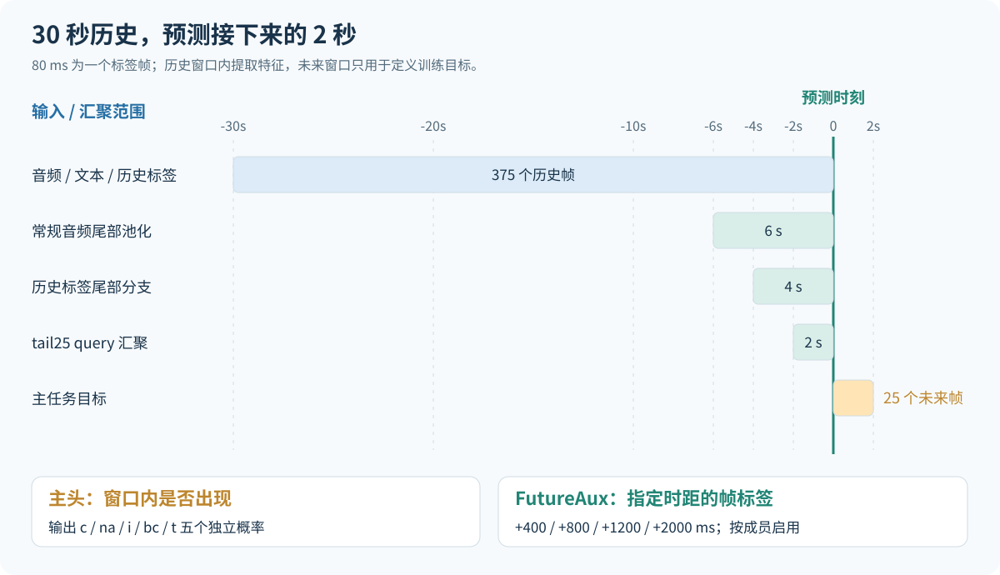
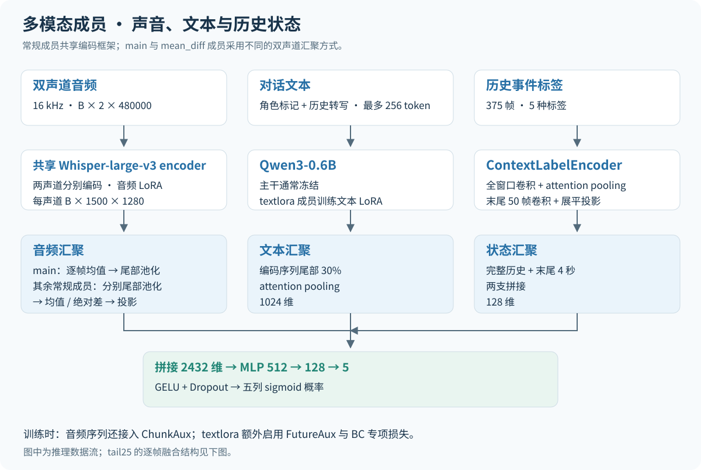
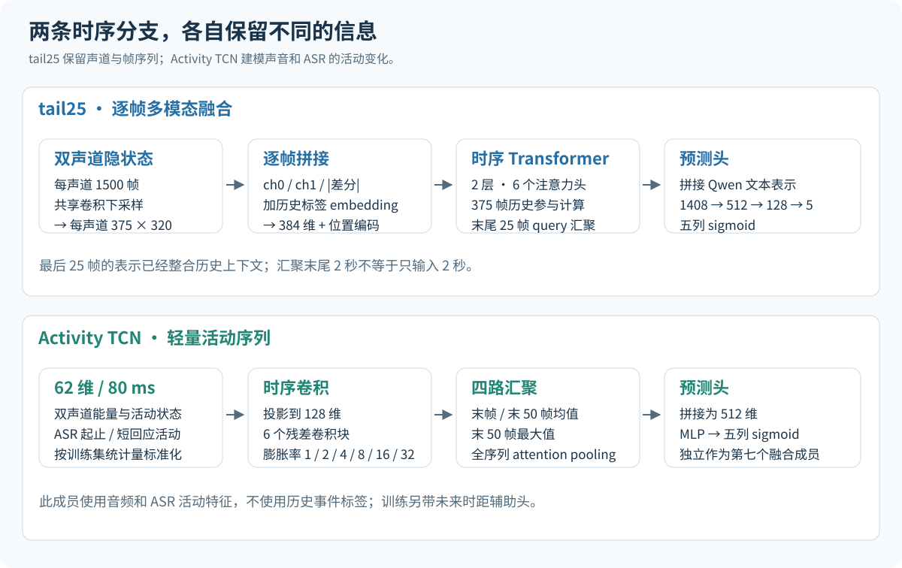
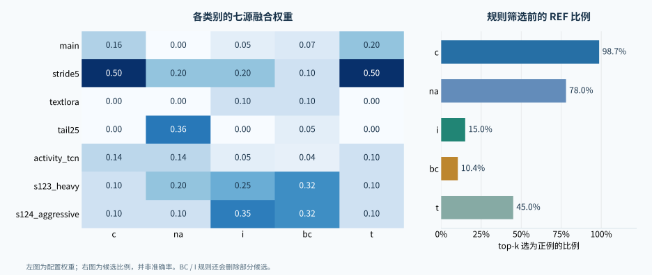
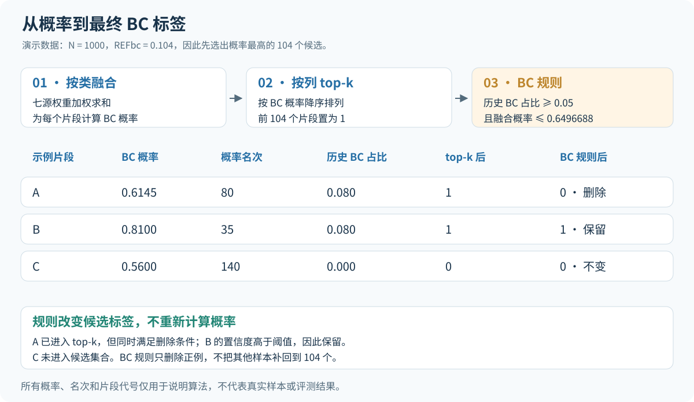

# 信也科技杯：多模态对话轮次预测

电话对话中的一次停顿，可能意味着说话者还要继续，也可能是另一方准备回应。信也科技杯 2026「对话轮次交互建模」复赛要求模型读取过去 **30 秒**的双声道音频、转写文本和历史事件标签，预测未来 **2 秒**内会发生哪些话轮事件。

本方案使用 **Whisper-large-v3 + Qwen3-0.6B** 建模语音与文本，结合历史状态和独立的活动时序模型，得到七组预测。随后按类别加权融合，通过 REF top-k 控制各类候选数量，再用历史附和比例和声学重叠特征筛选 BC、I 预测。最终配置为 **v161_bc104**，复赛最佳成绩为 **0.668080 macro F1**。



| 项目 | 最终方案 |
|---|---|
| 历史窗口 / 预测窗口 | 30 秒 / 2 秒 |
| 时间网格 | 每帧 80 ms，历史 375 帧、未来 25 帧 |
| 模型输入 | 双声道音频、转写文本、历史事件标签 |
| 模型输出 | c、na、i、bc、t 五个独立概率 |
| 融合成员 | 六个多模态成员 + 一个 Activity TCN |
| 最终决策 | 按类加权 → REF top-k → BC 规则 → I 规则 |
| 最佳成绩 | **0.668080 macro F1** |

**阅读导航：** [任务与输入](#任务与输入) · [多模态模型](#多模态模型) · [时序与活动分支](#时序与活动分支) · [训练目标](#训练目标) · [七个成员的区别](#七个成员的区别) · [融合与校准](#融合与校准) · [后处理规则](#后处理规则) · [代码导航](#代码导航)

## 任务与输入

### 预测窗口内的事件

模型在当前对话片段的末端做出判断。五列分别表示未来 2 秒内对应事件是否出现：

| 输出列 | 事件 | 含义 |
|---|---|---|
| c | 继续 | 当前说话者继续发言 |
| na | 无动作 | 无动作状态 |
| i | 未完成插话 | 另一方尝试插话，但没有完成话轮接管 |
| bc | 附和 | 听者给出短回应或反馈 |
| t | 话轮切换 | 发言从当前说话者转移到另一方 |

训练数据每个时间帧给出一个事件标签；主任务把未来 25 帧中出现过的类别转为五个二值目标。窗口内可以先后出现多种事件，所以五列采用独立 sigmoid，而非在五个类别中只选一个。

设未来帧标签为 $\ell_{t},\ldots,\ell_{t+24}$，类别 $c$ 的主任务目标为：

$$
y_c=\mathbb{1}\left[\exists k\in\{0,\ldots,24\}:\ell_{t+k}=c\right].
$$

这里的 $c$ 表示任意类别索引。训练标签的编码顺序是 `C=0, T=1, BC=2, I=3, NA=4`；输出概率与提交文件的列顺序则固定为 **c、na、i、bc、t**，二者需要按名称映射。

### 三类输入提供不同线索

音频保留两侧的说话活动和语音变化。原始电话音频为 8 kHz，模型侧重采样到 16 kHz；每段 30 秒对应每声道 480,000 个采样点。两个声道分别经过共享的 Whisper 编码器，保留各自的隐藏状态。

文本按时间窗口收集转写片段，并带有说话人标记。Qwen 编码器接收最多 256 个 token，随后对编码序列尾部 30% 做 attention pooling。它为语音分支补充内容信息，例如回应是否很短、句子在语义上是否仍在延续。

历史事件标签描述此前的对话状态。常规模型分别编码完整的 375 帧和末尾 50 帧，再拼接两路表示；前者提供长一些的历史，后者保留决策点前 4 秒的局部变化。

图中的“末尾 6 秒”指音频隐藏状态的池化范围，“末尾 2 秒”指 `tail25` 的 query 汇聚范围。Whisper 编码器仍然处理完整的 30 秒音频。

## 多模态模型



### 音频编码与双声道汇聚

模型在 GPU 上计算 Whisper 对齐的 log-mel 特征，随后使用 Whisper-large-v3 的 encoder。30 秒音频得到每声道约 1,500 个编码帧，每帧 1,280 维。音频主干通过 LoRA 微调，分类层和池化层参与训练。

常规成员有两种双声道处理方式。

`main` 在每个时间位置对两个声道的隐藏状态取均值，然后对末尾 300 帧进行 attention pooling，得到一个 1,280 维音频向量。这个成员使用最直接的声道合并方式。

`stride5`、`textlora`、`s123_heavy` 和 `s124_aggressive` 则分别池化两侧末尾 300 帧，得到 $u_0,u_1$，再拼接均值和绝对差：

$$
u_{\mathrm{mean}}=\frac{u_0+u_1}{2},\qquad
u_{\mathrm{diff}}=|u_0-u_1|,
$$

$$
a=\operatorname{GELU}\left(\operatorname{LayerNorm}\left(W_a[u_{\mathrm{mean}};u_{\mathrm{diff}}]+b_a\right)\right).
$$

均值保留两侧共有的表示，绝对差表达两侧活动的不同程度。投影将拼接后的 2,560 维恢复为 1,280 维，以便与其他输入融合。`tail25` 使用独立的逐帧结构，见下一节。

### 文本与历史状态编码

文本分支使用 Qwen3-0.6B，输出 1,024 维向量。除 `textlora` 外，多模态成员冻结文本主干；`textlora` 在文本注意力投影中加入 rank 为 8、alpha 为 16 的 LoRA。文本池化层仍是模型的一部分。

历史状态分支先把五种标签映射为 16 维 embedding。完整历史分支经过两层一维卷积和 attention pooling；末尾分支对最后 50 帧卷积后展平投影。两路各产生 64 维表示，拼接为 128 维。

### 三路融合与分类

常规模型拼接音频、文本和历史状态：

$$
f=[a;t;h]\in\mathbb{R}^{1280+1024+128}=\mathbb{R}^{2432}.
$$

随后通过 `2432 → 512 → 128 → 5` 的 MLP。隐藏层使用 GELU 和 dropout，输出为五个 logits，经过 sigmoid 后得到五列概率。每个成员独立生成一份 `[N, 5]` 概率矩阵，供后续融合使用。

## 时序与活动分支



### tail25：先建模逐帧关系，再汇聚段尾

`tail25` 将每个声道的 1,500 帧隐藏状态，通过 kernel 和 stride 均为 4 的一维卷积下采样到 375 帧，每帧 320 维，与历史标签的时间网格对齐。

每个时间位置拼接两个声道、它们的绝对差，以及该帧的历史标签 embedding。投影到 384 维并加入位置编码后，送入两层、六个注意力头的 Transformer。最后，一个可学习 query 对末尾 25 帧做 cross-attention，得到 384 维音频与状态表示。

这 25 帧已经通过 Transformer 整合了完整历史序列的信息。最终将它与 1,024 维文本表示拼接，使用 `1408 → 512 → 128 → 5` 分类头。历史标签在这一分支中于帧级接入，不再经过常规的 128 维状态汇聚分支。

### Activity TCN：直接建模说话活动

Activity TCN 使用每 80 ms 一帧的 **62 维活动特征**。音频部分包含双声道能量、峰值、活动掩码，以及重叠、静音、单侧活跃等组合状态；文本部分包含 ASR 活动、短回应、字符密度、话语起止等特征。该成员使用音频和转写信息，不输入历史事件标签。

特征按训练集统计量标准化，投影到 128 维后，依次经过六个残差时序卷积块，膨胀率为 `1、2、4、8、16、32`。输出序列从四个角度汇聚：最后一帧、末尾 50 帧均值、末尾 50 帧最大值和全序列 attention pooling。

四路拼接为 512 维，再由 MLP 生成五类事件概率。它与 Whisper/Qwen 成员使用不同的输入表示和网络结构，作为独立来源参与最终融合。训练时还带有多时距未来预测头，主推理输出仍为五列概率。

## 训练目标

### 主任务与逐帧辅助监督

六个多模态成员使用 Robust Asymmetric Loss 学习窗口级多标签目标。实现对正例项和负例项采用不同权重：负例聚焦指数为 4，正例聚焦指数为 0，负例 margin 为 0.05，并以 1.5 缩放负例损失。部分成员额外提高指定类别的正例权重。

这些设置降低容易负例的损失比重，让训练更多关注尚未分清的样本。聚焦权重本身不参与求导，最终分类仍由五列 logits 学习。

ChunkAux 把音频编码序列对齐到 375 帧，预测过去 30 秒每一帧的事件标签，使用 label smoothing 为 0.1 的交叉熵。主任务只给每个窗口五个目标，ChunkAux 则提供历史序列上的逐帧监督。

### FutureAux 与成员专用损失

`textlora` 和 `tail25` 额外启用 FutureAux，使用两个声道末尾隐藏状态，预测距当前时刻 **400、800、1200、2000 ms** 的帧标签。它预测各时距对应的单帧类别，与主任务“整个未来窗口是否出现”有所区别。

多模态成员的总损失可以写为：

$$
\mathcal{L}=\mathcal{L}_{\mathrm{ASL}}+
\lambda_{\mathrm{chunk}}\mathcal{L}_{\mathrm{chunk}}+
\lambda_{\mathrm{future}}\mathcal{L}_{\mathrm{future}}+
\lambda_{\mathrm{extra}}\mathcal{L}_{\mathrm{extra}}.
$$

未启用的项权重为 0。ChunkAux 权重按代码中的 epoch 索引分段取 `0.5 → 0.3 → 0.1`，切换点为 5 和 15。FutureAux 启用时权重为 0.3。

两项成员专用损失进一步形成训练差异：`textlora` 增加权重为 0.3 的 BC 二元交叉熵，其正例权重为 20；`tail25` 对目标恰好只有一类为正的二值样本，增加权重为 0.3 的 softmax 交叉熵。后者仅是一项辅助约束，最终输出仍为五列独立 sigmoid。

### 融合特征上的 Mix2

训练还在拼接后的融合特征上使用 Mix2。触发时，按相同系数混合两个或三个样本的特征与主任务标签，再重新计算分类头。它无需重新混合原始音频，也不会把不同样本的逐帧历史标签直接拼接。

默认触发概率为 0.5，Beta/Dirichlet 参数为 0.4，最多混合三个样本。辅助头仍对应原始输入上的监督。训练阶段与推理阶段由此保持相同的主干接口。

## 七个成员的区别

下表按已保存成员的配置与权重结构列出差异，对应摘要见 [member-architecture.json](docs/member-architecture.json)。

| 成员 | 音频 / 时序结构 | 文本主干 | 采样步长 | 额外训练项 |
|---|---|---|---|---|
| main | 双声道逐帧均值，段尾池化 | 冻结 | 25 帧 / 2 秒 | ChunkAux |
| stride5 | 双声道分别池化，均值 + 绝对差 | 冻结 | 5 帧 / 0.4 秒 | ChunkAux |
| textlora | 双声道分别池化，均值 + 绝对差 | 文本 LoRA | 25 帧 / 2 秒 | ChunkAux、FutureAux、BC BCE |
| tail25 | 375 帧 Transformer，末尾 25 帧 query | 冻结 | 25 帧 / 2 秒 | ChunkAux、FutureAux、单正类辅助 CE |
| activity_tcn | 62 维活动特征，六个残差卷积块 | 使用 ASR 活动特征 | 25 帧 / 2 秒 | 未来时距辅助头 |
| s123_heavy | 双声道分别池化，均值 + 绝对差 | 冻结 | 25 帧 / 2 秒 | ChunkAux、类别正例加权 |
| s124_aggressive | 双声道分别池化，均值 + 绝对差 | 冻结 | 25 帧 / 2 秒 | ChunkAux、类别正例加权 |

采样步长决定从一段训练对话中每隔多久构造一个窗口。`stride5` 增加相邻窗口的密度，输入仍为 30 秒，标签帧间隔仍为 80 ms。

前四个成员的音频 LoRA 使用 rank 16、alpha 32，注入 `q_proj/k_proj/v_proj/out_proj`；两个 seed 成员保持相同 rank 和 alpha，但只注入 `q_proj/v_proj`。因此，成员差异不仅来自随机种子，也来自参数更新的位置。

| 正例损失权重 | c | na | i | bc | t |
|---|---:|---:|---:|---:|---:|
| main / stride5 | 1.0 | 1.0 | 1.0 | 1.0 | 1.0 |
| textlora / tail25 | 1.0 | 1.0 | 1.5 | 3.0 | 1.5 |
| s123_heavy | 1.0 | 1.5 | 5.0 | 3.0 | 1.0 |
| s124_aggressive | 1.0 | 1.5 | 7.0 | 4.0 | 1.5 |

## 融合与校准

### 每个类别分别融合

同一个成员对不同类别的预测作用可能不同，最终方案为每个类别设置独立权重。设第 $m$ 个成员对样本 $i$、类别 $c$ 的概率为 $p_{i,c}^{(m)}$：

$$
p_{i,c}=\sum_{m=1}^{7}w_{m,c}p_{i,c}^{(m)},\qquad
\sum_{m=1}^{7}w_{m,c}=1.
$$

| 成员 | c | na | i | bc | t |
|---|---:|---:|---:|---:|---:|
| main | 0.16 | 0.00 | 0.05 | 0.07 | 0.20 |
| stride5 | 0.50 | 0.20 | 0.20 | 0.10 | 0.50 |
| textlora | 0.00 | 0.00 | 0.10 | 0.10 | 0.00 |
| tail25 | 0.00 | 0.36 | 0.00 | 0.05 | 0.00 |
| activity_tcn | 0.14 | 0.14 | 0.05 | 0.04 | 0.10 |
| s123_heavy | 0.10 | 0.20 | 0.25 | 0.32 | 0.10 |
| s124_aggressive | 0.10 | 0.10 | 0.35 | 0.32 | 0.10 |

在这组配置中，`stride5` 占 c、t 的一半权重；`tail25` 在 na 上占 0.36；两个 seed 成员合计占 i 的 0.60、bc 的 0.64。权重描述最终如何计算概率，本身不等于单个成员的性能或独立增益。



### 用 REF top-k 产生候选

最终二值化按每一列的概率排序进行。对 $N$ 个样本，类别 $c$ 选择：

$$
K_c=\operatorname{round}(N\cdot\mathrm{REF}_c)
$$

个最高分样本置为 1，其余置为 0。

| 类别 | c | na | i | bc | t |
|---|---:|---:|---:|---:|---:|
| REF | 0.987 | 0.780 | 0.150 | **0.104** | 0.450 |
| 当 N=1000 时的候选数 | 987 | 780 | 150 | **104** | 450 |

这些比例是最终选择的决策参数。REF 控制候选数量，模型概率决定具体哪些样本进入候选；它不是模型准确率，也不保证等于数据的真实正例率。

这种处理把候选数量与固定概率阈值分开。即使不同成员的概率尺度发生变化，只要某一列的排序相同，其 top-k 集合就相同。它同时使用整批样本的排序，因此批次组成与数据分布是使用这组 REF 时需要考虑的条件。

### 一次融合计算

假设某个片段的七个 BC 概率依次为：

```text
成员： main  stride5  textlora  tail25  activity  s123  s124
概率： 0.50    0.60      0.55    0.65      0.40  0.70  0.60
权重： 0.07    0.10      0.10    0.05      0.04  0.32  0.32
```

加权概率为 `0.6145`。它能否成为 BC 候选取决于在整列中的名次：若在 1000 个样本中排名第 80，就进入前 104 个候选。下一步再检查历史 BC 比例。这里的概率与名次是演示数据。

## 后处理规则

两条规则在 top-k 之后执行，读取融合概率作为置信度，并结合额外信息删除部分正例。先执行 BC 规则，再执行 I 规则；它们各自只修改对应的一列。

### BC：历史附和比例与当前置信度

BC 规则统计历史标签中 `BC` 的占比。若历史附和比例已经较高、当前候选的融合置信度又较低，就把 BC 从 1 改为 0：

```text
当前 bc == 1
并且 历史 BC 帧占比 >= 0.05
并且 融合 BC 概率 <= 0.6496687978506088
→ bc = 0
```

例如，上节片段的 BC 概率为 0.6145，若历史 BC 占比为 0.08，就满足删除条件。若同样的历史占比对应 0.81 的融合概率，则保留该候选。



### I：用末尾的声学重叠筛选候选

I 规则额外使用 callhome-zho 声学模型提取重叠说话概率。这一路输出用于规则判断，不作为第八个五分类成员参与加权。

模型先得到逐帧重叠概率，再统计历史窗口末尾 5 秒的均值 `ov_last5s`。当前 I 候选同时满足重叠较少和融合置信度较低时，将其删除：

```text
当前 i == 1
并且 ov_last5s <= 0.07141737639904025
并且 融合 I 概率 <= 0.7409622341394421
→ i = 0
```

规则只针对这一条件组合，不把“没有明显重叠”直接等同于“不会插话”。它使用当前时刻之前的音频信息，预测目标仍是之后的 2 秒。

两条规则都不补回新的候选，所以后处理后的正例数量可能低于 `round(REF × N)`。最终结果保持五列独立的二值预测。

## 结果与输出格式

最终配置 **v161_bc104** 的最佳成绩为 **0.668080 macro F1**。评价先分别计算五个类别的二分类 F1，再取平均：

$$
\operatorname{MacroF1}=\frac{1}{5}\sum_{c=1}^{5}\frac{2TP_c}{2TP_c+FP_c+FN_c}.
$$

五个类别在最终指标中占相同权重。融合表和 REF 表展示的是最终配置，不是各类别 F1 的分解。

| 阶段 | 输入 | 输出 |
|---|---|---|
| 单成员推理 | 对应片段的音频、文本、历史状态 | `[N, 5]` 概率和 N 个样本 ID |
| 七源融合 | 按相同 ID 顺序排列的七份概率 | `fused.npy`、`fused_ids.txt` |
| REF top-k | 融合概率 | `submission_base.csv` |
| BC 规则 | 候选、融合概率、历史标签 | `submission_bc.csv` |
| I 规则 | BC 处理结果、融合概率、声学重叠特征 | 最终预测 CSV |

CSV 列顺序为 `segment_id,c,na,i,bc,t`，五个预测列取值为 0 或 1。概率矩阵与 ID 文件必须逐行对应，所有成员也必须使用同一排序；规则所需的历史标签和声学特征通过 ID 关联。

## 代码导航

| 模块 | 文件 | 阅读重点 |
|---|---|---|
| 数据与目标 | [dataset.py](code/_lib/src/data/dataset.py) | 历史窗口、未来窗口和五列标签映射 |
| 常规模型 | [model.py](code/model/model.py) | 双声道编码、池化与多模态融合 |
| 时序模型 | [temporal_model.py](code/model/temporal_model.py) | 375 帧对齐、Transformer 和 tail query |
| 活动模型 | [tools_activity_tcn_train.py](code/tools_activity_tcn_train.py) | 活动特征、残差 TCN 和多路汇聚 |
| 损失与增强 | [losses.py](code/model/losses.py)、[mix2.py](code/model/mix2.py) | ASL、辅助监督和融合特征混合 |
| 训练 / 推理 | [train.py](code/train.py)、[infer.py](code/infer.py) | 模型装配与单成员概率输出 |
| 融合与校准 | [tools_fusion_to_csv.py](code/tools_fusion_to_csv.py) | 按类别加权和 REF top-k |
| 重叠特征 | [tools_acoustic_overlap.py](code/tools_acoustic_overlap.py) | 声学重叠概率提取 |
| BC 规则 | [tools_bc_refractory_rule.py](code/tools_bc_refractory_rule.py) | 历史 BC 占比与置信度联合筛选 |
| I 规则 | [tools_i_overlap_rule.py](code/tools_i_overlap_rule.py) | 末尾重叠特征与置信度联合筛选 |

最终融合参数在 [fusion_weights_7src_v30_nospecaug.json](rules/fusion_weights_7src_v30_nospecaug.json)，规则阈值在 [bc_refractory_rule.json](rules/bc_refractory_rule.json) 和 [i_overlap_rule.json](rules/i_overlap_rule.json)。

已有七份概率与 ID 文件时，融合调用如下，成员顺序与权重表一致：

```bash
python code/tools_fusion_to_csv.py \
  --test_probs main.npy stride5.npy textlora.npy tail25.npy activity.npy s123.npy s124.npy \
  --test_ids main_ids.txt stride5_ids.txt textlora_ids.txt tail25_ids.txt activity_ids.txt s123_ids.txt s124_ids.txt \
  --weights_json rules/fusion_weights_7src_v30_nospecaug.json \
  --out_probs fused.npy \
  --out_csv submission_base.csv \
  --out_ids fused_ids.txt
```

`submission_base.csv` 随后依次交给 BC、I 规则生成最终预测。完整数据和模型权重需另行准备；成员权重文件信息见 [model-files.json](docs/model-files.json)。
