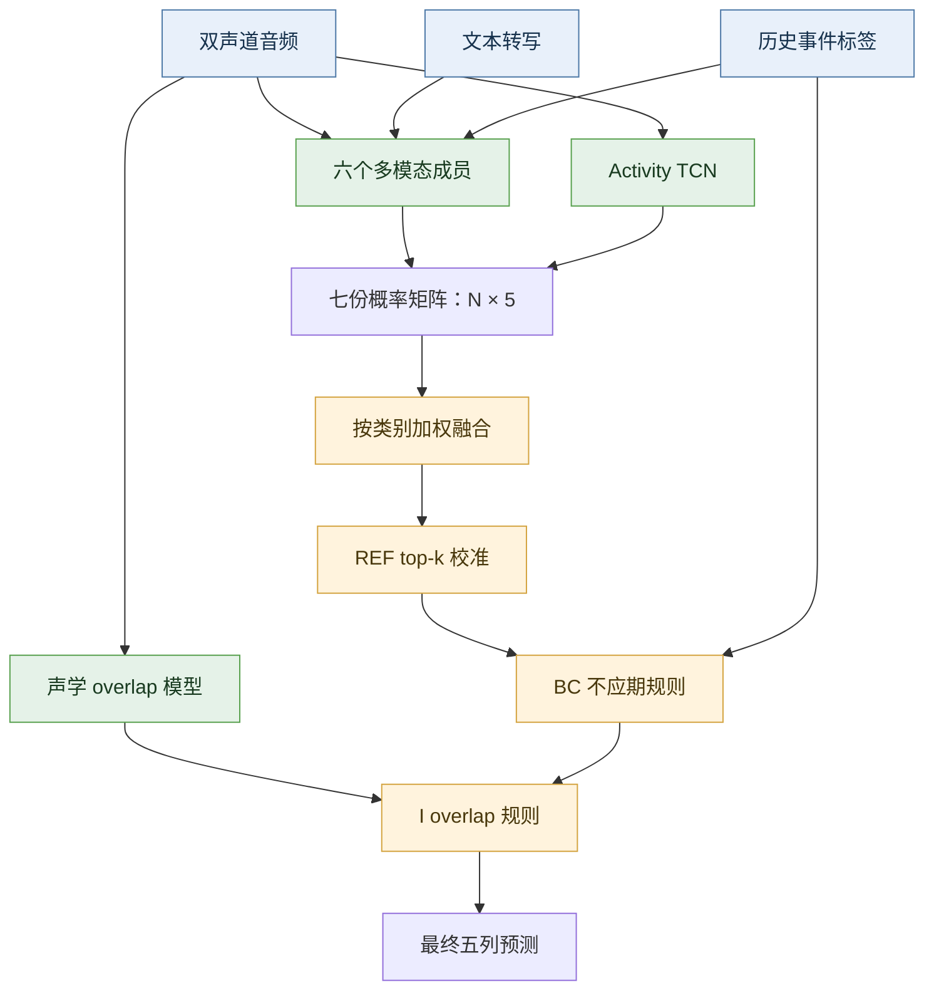
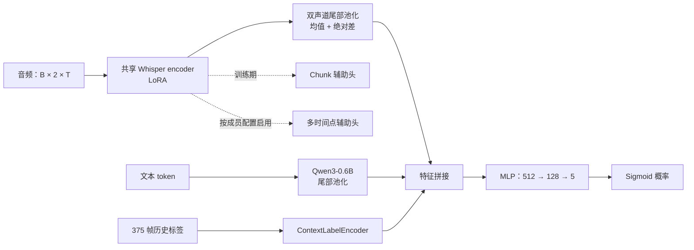
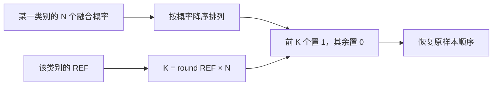

# 信也科技杯：多模态对话轮次预测

本方案用于信也科技杯 2026 复赛，通过对话音频、文本转写和历史事件标签，预测未来时间窗口中的话轮事件。最终采用 **v161_bc104** 配置，复赛最佳成绩为 **0.668080 macro F1**。

## 整体架构

一次预测使用过去 30 秒的双声道对话，判断随后 2 秒内是否出现指定的话轮事件。历史标签按 80 ms 划分，30 秒对应 375 帧；未来 2 秒对应 25 帧。五个输出采用多标签表示，一个片段可以出现多种事件。

整个流程先计算七个成员的概率，再按类别融合，最后处理输出比例和两类容易混淆的事件。额外的声学模型提取语音重叠特征，供 I 规则使用。



## 任务与模型

模型为每个对话片段输出五个独立概率，分别对应继续（c）、无动作（na）、未完成插话（i）、附和（bc）和话轮切换（t）。

音频部分使用 Whisper-large-v3 编码双声道语音，文本部分使用 Qwen3-0.6B，历史事件标签提供对话状态信息。音频编码器通过 LoRA 微调；大多数成员冻结文本主干，`textlora` 成员另行启用文本 LoRA。融合后的特征用于预测五类事件。训练中加入 chunk 级辅助监督，帮助模型学习片段内的事件变化。

最终使用六个多模态成员和一个 activity TCN。多模态成员通过帧步长、文本 LoRA、尾部建模及类别权重等训练设置形成差异；activity TCN 提供声学活动特征。各成员独立推理，再按类别融合概率。

### 单个多模态成员

常规成员分别编码两个声道，在末尾音频帧上进行 attention pooling，再用两个声道的均值和绝对差构造音频表示。均值保留共同信息，差分保留两侧说话活动的差异。文本和历史标签分别编码后，与音频表示拼接，经过 MLP 输出五个 logits。



Whisper 输入在模型侧按 16 kHz 处理，音频窗口为 30 秒。普通成员保留末尾 300 个编码帧用于池化，对应约 6 秒。文本最多使用 256 个 token，并侧重尾部表示。历史标签提供已发生事件的状态，帮助区分“继续说话”和“即将切换”等情况。

`tail25` 成员采用时序结构：两个声道分别下采样到 375 帧，与逐帧历史标签拼接，经过两层、六头的 Transformer，再以可学习 query 汇聚最后 25 帧。这一路保留了末尾 2 秒内的时间顺序。

### 训练目标与成员差异

主任务学习五类事件的多标签预测。Chunk 辅助头把音频编码序列对齐到 375 帧，并预测历史事件标签，为音频编码器提供逐帧监督。启用 FutureAux 的成员还预测 400、800、1200、2000 ms 四个时间点的标签；这些辅助头用于训练，最终提交使用主头的五列概率。

训练损失由主任务损失、带权的 Chunk 损失，以及按配置启用的 FutureAux 损失组成。辅助损失的开关和权重由各成员配置决定，并非七个成员共用一套训练设置。

| 成员 | 主要设置 | 融合中的作用 |
|---|---|---|
| main | 常规 Whisper LoRA，多模态融合 | 提供基础预测 |
| stride5 | 训练采样步长为 5 个 chunk | 在 c、t 上占较高权重 |
| textlora | Qwen 文本侧也启用 LoRA，rank 8、alpha 16 | 补充文本相关预测 |
| tail25 | 逐帧时序建模，汇聚末尾 25 帧 | 在 na 上占较高权重 |
| activity_tcn | 独立的声学活动 TCN | 提供额外的声学预测 |
| s123_heavy | seed 123，提高部分正类损失权重 | 主要参与 i、bc |
| s124_aggressive | seed 124，采用另一组正类权重 | 主要参与 i、bc |

各成员保留自己的训练配置和 checkpoint。下面的权重表决定它们如何组合成最终方案。

## 七源融合

五个类别分别使用一组权重。这样可以让同一个成员在不同类别中承担不同的预测比重。成员顺序及权重如下。

| 成员 | c | na | i | bc | t |
|---|---:|---:|---:|---:|---:|
| main | 0.16 | 0.00 | 0.05 | 0.07 | 0.20 |
| stride5 | 0.50 | 0.20 | 0.20 | 0.10 | 0.50 |
| textlora | 0.00 | 0.00 | 0.10 | 0.10 | 0.00 |
| tail25 | 0.00 | 0.36 | 0.00 | 0.05 | 0.00 |
| activity_tcn | 0.14 | 0.14 | 0.05 | 0.04 | 0.10 |
| s123_heavy | 0.10 | 0.20 | 0.25 | 0.32 | 0.10 |
| s124_aggressive | 0.10 | 0.10 | 0.35 | 0.32 | 0.10 |

每列权重之和为 1，融合概率为各成员概率的加权和。`s123_heavy` 和 `s124_aggressive` 在 i、bc 两类中的权重较高，`stride5` 则在 c、t 两类中占较大比重。

权重保存在 [融合配置](rules/fusion_weights_7src_v30_nospecaug.json)，实现位于 [tools_fusion_to_csv.py](code/tools_fusion_to_csv.py)。

### 权重分布可视化


左图颜色越深，表示该成员在对应类别中的权重越大。右图是进入后处理前的正例比例，并非各类别的准确率。BC 和 I 规则还会删除部分预测，因此最终提交中的正例比例可能低于图示值。

设第 $m$ 个成员对样本 $i$、类别 $c$ 的概率为 $p_{i,c}^{(m)}$，则融合结果为：

$$
p_{i,c}=\sum_{m=1}^{7}w_{m,c}p_{i,c}^{(m)},\qquad \sum_{m=1}^{7}w_{m,c}=1.
$$

融合前必须按样本 ID 对齐七份输出。仅有相同的数组形状还不够；如果行顺序不同，同一行就会混入不同对话的预测。代码会检查成员的 ID 列表是否一致。

## REF top-k 校准

训练标签与私域评测标签的分布存在差异，最终方案按类别控制预测为正的样本数量。对每一列融合概率降序排列，取前 `round(REF × N)` 个样本置为 1，其余置为 0。

| 类别 | c | na | i | bc | t |
|---|---:|---:|---:|---:|---:|
| REF | 0.987 | 0.780 | 0.150 | **0.104** | 0.450 |

这些比例根据比赛反馈调整，适用于本次评测的数据分布。以 bc 为例，校准阶段选取约 10.4% 的样本作为附和事件候选，随后再通过后处理规则删除部分候选。

### 从概率到二值预测

校准利用每个类别内部的概率排序。假设有 1000 个样本，`bc=0.104` 对应选择 104 个最高分样本作为 BC 候选。这个例子只说明 top-k 的计算方式；实际样本量由输入决定。



REF 控制候选数量，模型概率决定哪些样本进入候选。改变 REF 会改变正例集合的大小，但不会重新训练模型。后续规则再结合历史标签与声学特征筛选这些候选。

## BC 与 I 后处理

BC 规则结合历史附和比例和模型置信度。如果历史上下文中的 BC 比例较高，而当前预测的置信度较低，就将该样本的 BC 预测改为 0。

I 规则使用片段末尾 5 秒的语音重叠特征。如果语音重叠较少，且模型对插话的预测置信度较低，就将 I 预测改为 0。语音重叠特征由额外的声学模型提取。

两条规则均只删除符合条件的正例预测。完整处理顺序为：

```text
七个成员独立推理
    → 按类别加权融合
    → REF top-k 校准
    → BC 不应期规则
    → I overlap 规则
    → 五列事件预测
```

规则参数分别位于 [bc_refractory_rule.json](rules/bc_refractory_rule.json) 和 [i_overlap_rule.json](rules/i_overlap_rule.json)。

### 规则输入与执行顺序

| 规则 | 额外输入 | 删除条件 | 修改列 |
|---|---|---|---|
| BC 不应期 | 历史标签中的 BC 比例 | BC 比例高，且当前预测置信度低 | bc |
| I overlap | 末尾 5 秒的语音重叠特征 | 重叠较少，且当前预测置信度低 | i |

执行时保留融合概率供规则判断，同时将 top-k 得到的二值表作为初始预测。BC 规则产生中间表，I 规则读取这份表并生成最终输出。额外特征同样需要按样本 ID 对齐，不能直接沿用文件遍历顺序。

## 输入与输出

| 阶段 | 文件或张量 | 约定 |
|---|---|---|
| 单成员输入 | 音频、文本、历史标签 | 对应同一段对话窗口 |
| 单成员输出 | `.npy` 概率矩阵 | 形状 `[N, 5]`，列顺序为 c、na、i、bc、t |
| 样本索引 | ID 文本文件 | 第 i 行对应概率矩阵第 i 行 |
| 融合输出 | `fused.npy`、`fused_ids.txt` | 概率与 ID 对齐保存 |
| 校准输出 | `submission_base.csv` | 五列 0/1 预测 |
| 最终输出 | 后处理后的 CSV | 保持样本 ID 和列顺序 |

## 代码结构

| 位置 | 功能 |
|---|---|
| `code/train.py` | 多模态成员训练 |
| `code/infer.py` | 单成员推理 |
| `code/model/` | 模型、LoRA、损失函数与辅助头 |
| `code/_lib/src/` | 数据加载与公共工具 |
| `code/configs/` | 各成员训练配置 |
| `code/tools_activity_tcn_train.py` | activity TCN 训练 |
| `code/tools_activity_tcn_test_infer.py` | activity TCN 推理 |
| `code/tools_fusion_to_csv.py` | 七源融合与 top-k 校准 |
| `code/tools_acoustic_overlap.py` | 提取语音重叠特征 |
| `code/tools_bc_refractory_rule.py` | BC 后处理 |
| `code/tools_i_overlap_rule.py` | I 后处理 |

## 融合调用

输入为七份 `[N, 5]` 概率数组和对应的样本 ID 文件，成员顺序与权重表一致。

```bash
python code/tools_fusion_to_csv.py \
  --test_probs main.npy stride5.npy textlora.npy tail25.npy activity.npy s123.npy s124.npy \
  --test_ids main_ids.txt stride5_ids.txt textlora_ids.txt tail25_ids.txt activity_ids.txt s123_ids.txt s124_ids.txt \
  --weights_json rules/fusion_weights_7src_v30_nospecaug.json \
  --out_probs fused.npy \
  --out_csv submission_base.csv \
  --out_ids fused_ids.txt
```

`submission_base.csv` 是 top-k 校准后的结果，之后依次执行 BC 和 I 规则得到最终预测。数据与模型权重需另行准备，七个成员的权重文件清单见 [model-files.json](docs/model-files.json)。
